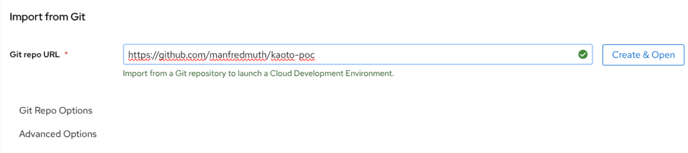
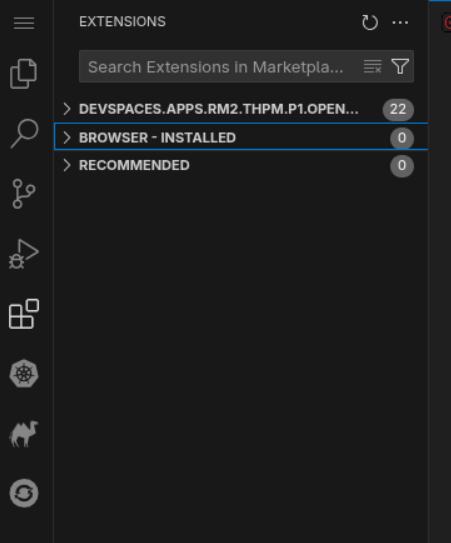
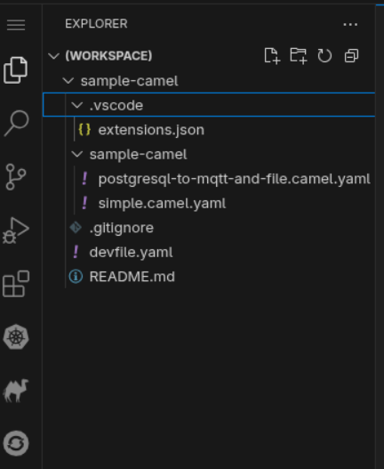

# kaoto example

This example initially uses developer workspaces to show how easy you can get kaoto VS Code extensions up and running by using OpenShift DevSpaces.

- [Red Hat Developer sandbox](https://developers.redhat.com/products/openshift-dev-spaces/overview)
- Once you started a workspace you want to use the [GIT repo for kaoto](https://github.com/manfredmuth/kaoto-poc)



What happens now is that the che cluster - base of DevSpace - will deploy a DevSpace in your namespace and it will use the `devfile.yaml` which is in the root directory of the GIT repo.
The VS Code extensions are installed based on what you define in [.vscode/extensions.json](.vscode/extensions.json). VS Code will always look for this directory and process it.

---

In the devfile you will find an entry which looks like:

```
commands:
  - id: install-jbang
    exec:
      component: tools
      workingDir: /projects
      commandLine: |
        set -eu
        if ! command -v jbang >/dev/null 2>&1; then
          curl -Ls https://sh.jbang.dev | bash -s - app setup
        fi
        export PATH="${HOME}/.jbang/bin:${PATH}"
        grep -q '.jbang/bin' "${HOME}/.bashrc" || echo 'export PATH="${HOME}/.jbang/bin:${PATH}"' >> "${HOME}/.bashrc"
        jbang trust add https://github.com/apache/camel
        jbang app install camel@apache/camel
        jbang version
        camel version
events:
  postStart:
    - install-jbang
``` 

And this will take care that the relevant VSCode extensions are installed once the IDE is started. Be patient it will take a second. And be aware that thes extensions are curated. This way a kaoto operator on the OpenShift cluster is not needed

Once the extensions are installed you will see those in the sidebar of your IDE



---

You will also see that 

